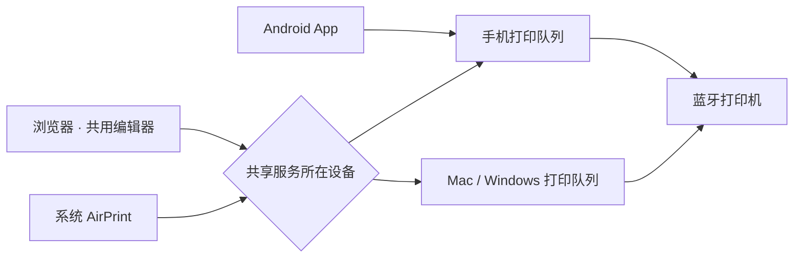

# mijia-print-studio · 留影工坊

米家桌面照片打印机 2 的非官方蓝牙打印工具，提供 Android App、Web 编辑器和 AirPrint。只维护蓝牙后端。



手机、Mac 和 Windows 可独立运行，每台设备串行打印、按需连接蓝牙；不同设备需轮流使用打印机。

## 功能

| 类别 | 功能 |
| --- | --- |
| 相纸 | 自动识别三寸方形背胶、六寸；六寸支持两张四寸拼接 |
| 照片 | 最多六张，每张独立裁剪、色调、模板、文字和表情；完整照片与虚线打印范围 |
| 创作 | 16 款原创模板、姓名贴与间隙调整、农历月历、卡片、ID 卡贴、拼图、拍立得 |
| 人像 | 离线人脸保护裁剪；证件照自动抠图、白/蓝/红底，保留原图 |
| 覆膜 | 高亮及纹理，可将单个文字或表情隐藏到覆膜 |
| 共享 | Web 配对访问、AirPrint 独立开关；失败通知与历史、按原图和覆膜精确重印；结果未知时暂停、不自动重印 |

照片排版提供铺满、完整保留和底部留白，白边或底部留白可调至 200px。

## Android

需要 Python 3、JDK、Android SDK（platforms/android-36、build-tools/37.0.0）。设置 `JAVA_HOME` 和 `ANDROID_HOME`：

```sh
python3 fetch_deps.py
python3 build.py
adb install -r build/liuying-studio.apk
```

首次构建生成本地调试签名，覆盖安装须沿用原密钥；模型、依赖、密钥和安装包不提交。

1. 在系统蓝牙中配对打印机，打开 App；若存在多台匹配设备，先保留目标配对。
2. 选择照片、编辑并预览，确认实际相纸后打印。
3. 需要其他设备访问时，在「更多 → 共享打印」开启 Web 或 AirPrint。

Web 地址和配对码在 App 中显示，端口 8634；本机直接使用 App。AirPrint 端口 8637，可从系统打印菜单访问。共享须在解锁后的 App 前台开启，后台保留通知；强制停止或省电限制可能中断服务。

App 和 Web 中本人提交的已完成记录可按原参数重印，须再次确认；批次缺页或文件缺失时不可重印。浏览器保留归属 Cookie 后，重新配对可恢复自己的照片与历史；清除 Cookie 或升级前已丢失的临时浏览器身份无法恢复。重新配对不会自动重放任务。

## Mac

需要 Python 3.12+、Xcode Command Line Tools；在系统中配对打印机。

```sh
python3 -m venv build/venv
build/venv/bin/pip install -r web/requirements.txt
python3 web/build_bluetooth.py
build/venv/bin/python airprint/build_renderer.py
build/venv/bin/python desktop/serve.py --simulate
```

默认 Web 地址 `http://127.0.0.1:8635`，配对码显示在终端；AirPrint 端口 8636。模拟模式不连接打印机，也不广播 AirPrint。

真实打印设置环境变量 `MIJIA_BLUETOOTH_ADDRESS` 为目标设备地址，并去掉 `--simulate`。停止旧服务后启动；同一打印机不允许重复启动本项目服务。

- `--entry web` / `--entry airprint`：只启用对应入口，默认同时启用。
- `--lan --hostname 主机名.local --allow-network 可信网段 --announce`：开放局域网并广播 AirPrint，填写本机实际 Bonjour 名和可信网段。
- 默认自动检测纸盒；六寸可在 Web 中切换 AirPrint 拼接，或用 `--paper splice` 设置启动默认值。换纸后自动刷新，发送前再次校验。

数据存于 `~/Library/Application Support/LiuyingStudio`。Mac 本机配对后可核对异常队列；本人历史支持按原图、覆膜及参数精确重印。旧项目数据不会自动迁移或重放。

抠图和人脸检测模型通过 `python3 fetch_deps.py` 下载，推理离线执行。HEIC 使用 macOS 系统转换。

## Windows

使用 Windows 10/11、Python 3.12 64位和支持经典蓝牙的适配器。服务运行于原生Windows，不能在WSL中直接连接打印机；无需安装Mac工具或Android SDK。

在PowerShell进入仓库目录：

```powershell
py -3.12 -m venv build/venv
.\build\venv\Scripts\python.exe -m pip install -r desktop/requirements-windows.txt
.\build\venv\Scripts\python.exe desktop/windows.py --simulate
```

本机打开 `http://127.0.0.1:8635`，输入终端配对码。模拟模式只验证流程，不连接打印机。

真实使用先在Windows设置中配对打印机，再设置地址并启动：

```powershell
$env:MIJIA_BLUETOOTH_ADDRESS = '打印机蓝牙地址'
.\build\venv\Scripts\python.exe desktop/windows.py --lan --announce --address 192.168.1.20 --allow-network 192.168.1.0/24
```

示例IP和网段需替换为这台电脑的局域网IPv4和可信网段。其他设备访问 `http://电脑IP:8635`，或在系统打印菜单选择此电脑共享的打印机。`--entry web` / `--entry airprint` 可分别启动；六寸拼接设置与Mac相同。

Windows防火墙需允许所用Python在专用网络接收TCP 8635/8636及UDP 5353；只在可信局域网开放。保持电脑唤醒和服务进程运行，Ctrl+C停止。数据默认在 `%LOCALAPPDATA%\MijiaPrintStudio`，可用 `--data` 指定其他目录。

PDF使用PDFium完整保留整页；HEIC使用本地解码库。需要人脸检测/抠图时先运行 `python fetch_deps.py` 下载离线模型。安装的依赖保留其附带许可证；不需要安装Bonjour软件。

Windows提供离线自动化测试；蓝牙适配器兼容性和最终实物打印仍需Windows真机验收。

## 共享与输出限制

Web 使用配对码和会话隔离；AirPrint 无账号认证，仅在可信局域网使用，不映射公网。Web 使用 HTTP。两入口可分别关闭，已经开始的打印不会因关闭入口重发。

AirPrint 支持 JPEG、PDF、单页 URF/PWG；PDF 最多六页，拼接只支持 JPEG/PDF，每两页一张纸，奇数末页重复。每任务一份，不支持的格式或参数明确拒绝。只有打印机状态和纸型可用时广播，客户端发现缓存可能延迟更新。

Mac 可提取照片型 PDF；Android / Windows PDF 完整保留整页。两端图像编码不同，不承诺逐像素相同。导入图像最长边 2400，极端放大可能损失细节。

## 开发与测试

`assets/` 是唯一编辑器与合成代码；`src/` 为 Android 适配；`printing/` 为桌面公共队列；Web 与 AirPrint 入口不互相依赖。接口见 [web/CONTRACT.md](web/CONTRACT.md)。

```sh
build/venv/bin/pip install -r requirements-test.txt
build/venv/bin/python -m unittest discover -s tests -p 'test_*.py'
python3 tests/check_release_assets.py
```

浏览器测试需 Playwright 与浏览器，参见 `tests/check_desktop_web.py`、`tests/check_ui_parity.py`。设备测试需 ADB 和已安装的 App；运行前保存草稿。回归测试不自动实物打印，合成色卡生成器位于 `tests/generate_print_charts.py` 和 `tests/generate_square_chart.py`。

## 许可

原创代码及素材采用 [MIT](LICENSE)；第三方表情、字体、模型保留各自许可，见 [THIRD_PARTY.md](THIRD_PARTY.md)。仅对有权使用的设备进行操作。
